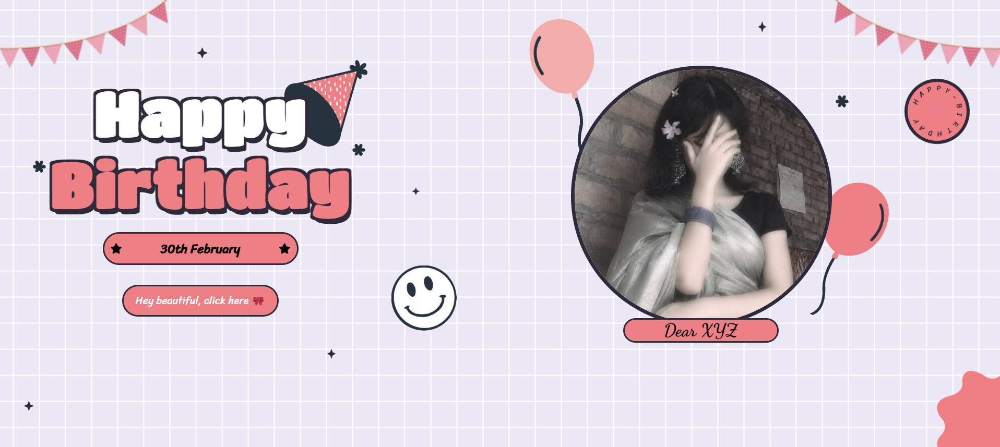

# Birthday Surprise Website

A small, animated birthday greeting website built with **HTML, CSS, and vanilla JavaScript**. It presents a birthday-themed landing page with animated decorations, a photo, and an interactive greeting card that opens when the visitor clicks the button.

## Preview



## Features

- Animated “Happy Birthday” heading and entrance effects.
- Birthday-themed decorations, including flags, balloons, stars, flowers, and a rotating badge.
- Personal photo display with a name label.
- Animated date text.
- Interactive birthday button that opens a two-panel greeting card.
- Close control to dismiss the greeting popup.
- Responsive viewport metadata for mobile browsers.

## Built With

- **HTML5** — page structure and content.
- **CSS3** — layout, colors, transitions, and keyframe animations.
- **JavaScript** — date text animation and greeting-card open/close interactions.
- **Google Fonts** — decorative typography.
- **Font Awesome 6.5.1** — icons.

## Project Structure

```text
birthday-exe-main/
├── bday.html
├── bday.css
├── bday.js
├── README.md
└── images/
    ├── birthday-preview.png
    ├── 1.png
    ├── abc.jpg
    ├── xyz.jpeg
    ├── balloon1.png
    ├── balloon2.png
    ├── decorate.png
    ├── decorate_flower.png
    ├── hat.png
    ├── heart.png
    ├── heart_letter.png
    ├── love.png
    ├── mewmew.gif
    └── smiley_icon.png
```

## Run Locally

No build tools or package installation are required.

1. Download or clone this repository.
2. Keep `bday.html`, `bday.css`, `bday.js`, and the `images/` directory together.
3. Open `bday.html` in a web browser.

For a local development server, you can use the VS Code **Live Server** extension and open `bday.html` with it.

## Personalization

Update the following values before sharing the page:

| File | What to edit |
|---|---|
| `bday.html` | Page title, displayed name, photo references, button text, and birthday message |
| `bday.js` | `dateText` value used for the animated date |
| `bday.css` | Color variables, typography, layout, and animation styles |
| `images/` | Replace the existing photos and decorative assets while keeping filenames the same, or update the corresponding image paths in `bday.html` |

### Important placeholders

The current source includes placeholder-style content such as `XYZ`, a date string of `30th February`, and a personal greeting message. Replace these with the intended recipient's details. **30th February is not a valid calendar date.**

## External Resources

The page loads Google Fonts and Font Awesome from external CDNs, so an internet connection is needed for those resources. The local HTML, CSS, JavaScript, and image assets remain in the project.

## License

No license is specified in the supplied project. Add a `LICENSE` file if you intend to publish the project for reuse by others.
